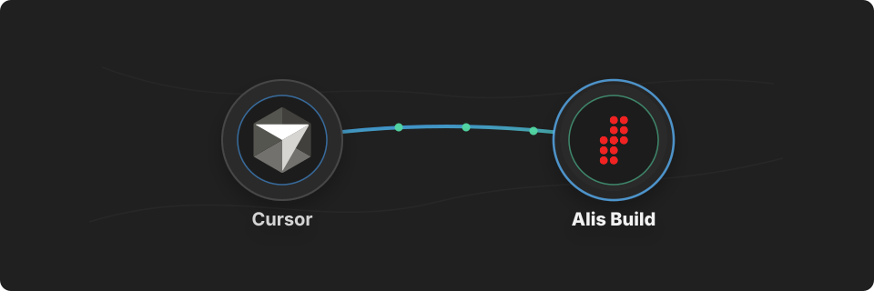

# Alis Build plugin for Cursor

This prepared update aligns terminology and artifact reading with the coordinated
CLI copy pass (proposed CLI 1.174.2). Publish the CLI and plugins together.

<p align="center">
  
</p>

<p align="center">
  <strong>Connect Cursor to Alis Build.</strong>
</p>

Use this plugin to let Cursor work with build environments, products, services, builds, and deploys through the `alis` CLI, with workspace-aware context injected into every session.

## What You Get

- A standing Define → Build → Deploy primer rule with quiet, local-first skill discovery — description-triggered `discover` and `capture` rules fire on your own words (`alis skills suggest|load|capture`), never on generic coding just because you are inside a workspace
- Catalogue metadata refreshed quietly at session start; the plugin never installs or prunes native user skills
- Auto-approval of clean `alis …` CLI commands via a `beforeShellExecution` hook, with `--confirm-production` / `--approve` / `blocks uninstall --yes` and the secret-printing `environment variables|vars|refresh` / `--reveal` always prompting (double-keyed)
- A `postToolUse` hook that warns the agent when a tool call carried secret-looking values (keys, connection strings, private keys, revealed environment values), so it never repeats them and tells you to rotate them; values never appear in the warning

## Before You Start

You need:

- Cursor with plugin support
- The `alis` CLI installed, on your `PATH`, and signed in (`alis login`)
- An Alis Build account with access to the build environments and products you want to use

## Install

Install this repository as a Cursor plugin marketplace, then install the `tools` plugin from that marketplace.

## Use It

After installing, ask Cursor to use Alis Build — just describe what you want:

```text
Add a search endpoint to my orders service.
```

```text
Use Alis Build to list the build environments I can access.
```

```text
Use Alis Build to inspect the current workspace, product, active neurons, and recent build status.
```

```text
Use Alis Build to review the latest failed build or deploy logs and suggest the next action.
```

## Workflow Rules

This plugin includes description-triggered Cursor rules for Alis Build workflows:

- **`discover`** — finds and loads the right Alis Build skill for what you want to do — local-first: it probes the local catalogue (`alis skills suggest --json`, ~40ms, no network), loads a registry skill only on a distinctive match, and stays quiet otherwise (`alis skills search` is reserved for explicit "find me a skill" asks). Cursor applies it when your request touches the platform — describe the goal in your own words; no wake word is needed. It does not fire on generic coding (Makefiles, ordinary bugs, tests, git) just because you are inside a workspace.
- **`capture`** — turns work just completed in the session into a reusable skill for your team. Say "capture this as a skill" (or "make this a skill" / "skillify this").
- **`frontend-preview`** — shows a service's web frontend in the browser the agent's own tools drive and checks it there (`alis preview --json` for the address, then Cursor's browser or a Playwright MCP to inspect, click and read the console in the user's own browser). The CLI installs and launches nothing; on a workstation the shell's Chrome pane shows the browser the agent drives. Never used for logs or operation status.
- **`getting-started`** — say "Use the getting-started skill to help me get started on Alis Build."

## Validate

```sh
node scripts/validate-template.mjs
for test in plugins/tools/hooks/*.test.sh; do bash "$test"; done
```

## Conversation reading and package setup

Read referenced conversations before proposing changes: use
`alis specialist get tickets/ID --json`, or find the title with
`alis specialist tickets --state all --json`. Use `alis packages install`
for private package setup during Build. Read command results and help in full.

If this guidance is absent after updating, confirm the Alis plugin is enabled
and restart the agent. The CLI alone does not activate the agent plugin.
For immediate guidance, read `alis docs specialist` and
`alis packages install --help`.

## Troubleshooting

The plugin uses native hook protocol 1 in the `alis` binary. Upgrade the CLI
first with `alis upgrade`; `alis hooks capabilities` must report `"protocol":1`.
Restart the coding agent after updating. Python is not a runtime dependency.
Older CLIs receive one startup upgrade notice; optional native checks wait for
the upgrade, and existing handoff claims remain fenced by the compatibility
adapter. Bash and `jq` are still used by the other plugin hooks.

If the rules or hooks do not take effect, confirm the plugin install completed and reload Cursor.

If `alis` commands fail with an auth error, run `alis login` (or `alis authorise <org>.<product>` for git/package credentials) and retry.

## Workstation handoff in herdr

The `handoff` rule opens and monitors existing Alis handoffs with `open <id>` and
`status <id> --watch`. Herdr groups a product in a space such as `alis.os`, a
service in a tab such as `cli.v1`, and each continuation in its own pane. Native
Claude/OpenCode sessions resume with “Continue where you left off.” Codex and
Antigravity CLI sessions require an explicit summary choice.

**Automatic Cursor transfer is not supported in this release**, including the
coordinator's summary mode. For Cursor work, the rule can prepare a short manual
continuation note with the next step and exact active Alis operation IDs. That
note does not transfer files, migrate processes, or start a remote session.
The capability manifest therefore advertises no Cursor transfer modes.

Start supported transfers inside the corresponding source agent with its matching
Alis plugin. Keep the laptop awake until `safe_to_close: true`; upload or pane
creation alone is insufficient. The remote continuation survives closing its
browser terminal. Matching CLI and workstation runtime releases are required.

## Native hook development checks

Run `ALIS_TEST_CLI=/absolute/path/to/alis-dev python3 -B tests/test_native_hooks.py`
to check the bridges against a built CLI with Python absent from the hook PATH.
Python is only a development test runner. Native handler tests live in the CLI.
